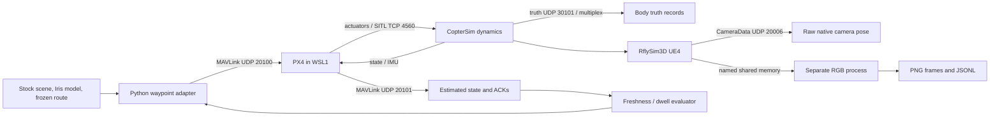

# Installed RflySim interface and reproduction guide

Measured on 10 October 2026. See [results](../../results/rflysim/eval-20261010T215531Z/README.md), [failures](../../results/rflysim/eval-20261010T215531Z/failures.md) and historical [source investigation](sources.md). The instance is Off. These commands describe a future authorized repeat, not commands to start the machine now.

## Component interpretation

The scripted supervisor selects targets and checks fresh estimate dwell. PX4 estimates motion and stabilizes through position/velocity/attitude/rate loops. CopterSim advances the stock vehicle dynamics. RflySim3D renders the stock camera. The recorder exports pixels/state independently. Images did not enter control. These tested building blocks are useful without an unattended helper or pretrained visual policy.

B1 ULog parsing now recovers firmware `a301969dc209c166b9fbbb524bd51ca1ece76b04`, 660 initial PX4 parameters and 11 startup changes. [Offline records](../../results/rflysim/handoff-20261011T220420Z/native-log-summary.json). The stock configuration changed failsafe-related parameters early in startup, although our adapter avoided the side-effecting helpers. Responsible launcher source remains unresolved. Physical dynamics coefficients are not recovered by PX4 parameters.

**Architecture matters:** offline motion replay to a Gaussian renderer can use a chosen exported body frame plus its own camera model/time. Native UE camera calibration is required for native geometric RGB association/comparison, not automatically for that external architecture. Depth/contact services are required only by tasks that need them.

[Current minimal follow-up](minimal-followup.md) supersedes a blanket rerun. The commands below retain the historical full reproduction contract, not an instruction to rerun passed B1/B2 now.

## Input-to-output path



**Demonstrated:** Python commands, PX4 mode/arm ACKs, dynamics-linked estimates, multiplex and UDP truth, native camera metadata, RGB files. The calibrated association between body/camera acquisition time and each image remains **blocked**. RGB does not drive this controller. No learned weights or reconstruction enter this path.

## Owners, interfaces and clocks

Canonical SDK lives at `C:\Users\user\Documents\RflySim\RflySimAPIs\RflySimSDK`. Installed source snapshots are ignored local artifacts under `artifacts/rflysim/extension-20261010T204353Z/final/sdk-small/`; hashes in the [installed manifest](../../results/rflysim/extension-20261010T204353Z/installed-sdk-manifest.json). Public repository HEAD does not identify these binaries.

| Stage | Inspected implementation | Meaning and measured limit |
|---|---|---|
| Python control | Authored `installed_adapter.py`, `Link`, `flight`, `cleanup` | `SendPosNED` at target10 Hz. Local NED metres, yaw radians. Independent process watchdog75s and separate cleanup15s, perSDK call2s. Raw queues8192, essential overflow invalidates evidence. |
| PX4 | Installed `ctrl/PX4MavCtrlV4.py:296,1290,1531,2005` | `PX4MavCtrler(1,'127.0.0.1')`, UDP mode2. Commands/setpoints20100, receive20101. CMD176 OFFBOARD/main mode6, CMD400 ordinary arm/disarm, CMD21 land. Mode/armed confirmation comes from fresh raw heartbeat and ACKs, not command return. |
| Raw state | Same file `:3137,3198`; own nonblocking MAVLink receive | LOCAL_POSITION_NED20 Hz, time_boot_ms is PX4 boot time. Freshness0.5 s. EXTENDED_SYS_STATE ON_GROUND=1, velocity norm≤0.2m/s for2s, fresh disarmed heartbeat. Heartbeat stream stays1Hz despite CMD511 interval; CMD512 requests new messages5Hz. Raw provenance and source system/component retained. |
| Dangerous convenience calls | `InitMavLoop:1095`, `initOffboard:2285` | Auto-disarm/thread behavior and failsafe/automatic arming changes inspected. Adapter does not call these helpers or alter failsafe parameters. |
| Dynamics truth | `InitTrueDataLoop:863`; `getMavMsg:3227–3245` | UDP30101 typed168-byte body packet and HIL_ACTUATOR_CONTROLS flag1234567890 multiplex. Raw controls3:6 position, 6:9 velocity, 0:3 attitude. Multiplex raw time_usec scaling unverified. True map origin differs from PX4 local origin. Offline receive-nearest initial-offset fit is diagnostic only. |
| Native camera | `UE4CtrlAPI.py:372,1609,1797,1815,2040,2089` | CameraData56/72-byte packets, UDP20006, position/Euler/quaternion/FOV/dimensions/native clock exported independently. Actual timestamped packets exist. Optical axes and acquisition-time correspondence require calibration. |
| Sensor command | `VisionCaptureApi.py:275,1123,1278` | One Type1 RGB, Seq0, vehicle1, mount0 B or2 A, 640×480, 10 Hz, 90° FOV. `SensorPosXYZ` documented metres, `SensorAngEular` documented **degrees**, quaternionwxyz. Executed A incorrectly converted degrees to radians. Local corrected code has not been simulator retested. |
| RGB transport | Same file `img_mem_thrd:2675`, timestamp`:2796`, flags`:2843–2860`, `startImgCap:3207` | Named mapping `RflySim3DImg_0`, 921609bytes, 1-byteflag+8-bytedouble+pixels. Capture process owns copy and PNG encoding, marks ready2→reading3→copied4. No pixel/file/GPU work in control. BGR documented; independent color/orientation check pending. Frame log receipt is after encoding, not acquisition. |
| External forwarding | `sendImgBuffer:3308` | Consumer forwarding exists in source. No supported native-RGB injection or visual-policy observation adapter demonstrated. |
| Reset/time | Reviewed authored stock batch and WSL lifecycle | Full audit-owned WSL1 restart solved stale PX4 daemon and B2 began fresh/disarmed/on-ground. No verified deterministic step/pause or lockstep sensor acquisition service. A recreated camera actors in same scene, not verified whole-world deterministic reset. |
| Geometry | UE collision/crash return and Type2 depth documented | Neither contacts nor depth semantics measured. Removing UE also raises collision/depth ownership questions; Gaussian radiance does not define validated contact geometry. |

Source URLs checked10 October2026: [sensor protocol](https://rflysim.com/doc/en/4.DevRef/vis-cfg.html), especially rows420–423 (metres/degrees/wxyz), [UE API](https://rflysim.com/doc/en/4.DevRef/pysdk/ue/ue4ctrl.html), [main protocol](https://rflysim.com/doc/en/4.DevRef/protocol.html). Installed sources, exact hash and line references above remain stronger for this release. Numeric native metadata Euler/quaternions suggest the tiny executed rotations caused by our degree conversion, consistent with official documentation.

### Calibration and timing contract

Desired FRD camera offset(0.3, 0, 0)m with zero relative attitude. Desired camera axes/optical transform matrices are preserved in `audit-config.json`; they were not independently verified. World-fixed A used provisional stock map Zoffset−8.05m from GUI. No surveyed geometry or calibrated intrinsics supplied. FOV90° axis/projection is unknown, so do not derive an asserted intrinsic matrix.

Preserved frame records have frame IDs, raw native timestamps, receipt monotonic/UTC, dimensions via configuration, pose-command labels and paths/hashes in archive manifests. AcquisitionUTC is explicitly null. Body truth, camera metadata and PX4 clocks remain distinct. Desired association is bracketed truth at acquisition time, linear translation/quaternionSLERP, bracket gap≤0.1 s, measured clock residual≤0.02 s, no extrapolation. This was not established. A2 first frame had an old-looking timestamp257.636 versus pose425.638; the next image jumped169.123 native units, then returned near the current clock. Preserve this warmup anomaly; no camera latency or stale-frame count can be inferred solely from duplicate timestamps.

A criteria remain0.02m/1° repeat agreement and feature residual≤2%image dimension with verified geometry. These audit thresholds are not lab fidelity requirements. Geometric outcome remains blocked, and desired rotation execution failed due authored conversion. p0…p6 positions and durations are unchanged in copied run configs.

## Exact repeat commands and setup boundary

Installation already exists; do not redownload/reinstall blindly. Stock executable launches require a logged-in GPU desktop (Moonlight), not an unverified SSH service graphics session. WSL distro must be mode1 (`wsl -l -v`), not WSL2. Routine shell/control/data analysis can run through command access once available; graphics still needs the interactive session. External SSH was not repaired in this allowance.

On an authorized restart, inspect existing components and preserve any dirty authored files. Use a fresh output directory. The following checkout is a **proposed repeat location**, not a claim that Windows Git synchronization was completed. Transfer the same branch through private Drive/Git bundle if remote Git authentication is unavailable; never copy personal GitHub credentials.

```powershell
$install = 'C:\Users\user\Documents\RflySim'
$checkout = 'C:\Users\user\Documents\R4R-Sims-rflysim'
$code = Join-Path $checkout 'simulators\rflysim'
$runRoot = Join-Path $checkout ('artifacts\rflysim\repeat-' + (Get-Date -Format 'yyyyMMddTHHmmss'))
New-Item -ItemType Directory -Path $runRoot -ErrorAction Stop | Out-Null
# Resolve the installed Python via its installed environment, verify version/dependencies.
$python = (Get-Command python.exe -ErrorAction Stop).Source
& $python -c "import sys,cv2,numpy,pymavlink; print(sys.version); print(cv2.__version__); print(numpy.__version__)"
if ($LASTEXITCODE -ne 0) { throw 'Installed Python dependencies unavailable' }
wsl.exe --list --verbose
# Interactive desktop: correct CWD is required. Parent/engine PIDs must both be tracked.
$renderer = Start-Process (Join-Path $install 'RflySim3D\RflySim3D.exe') `
  -WorkingDirectory (Join-Path $install 'RflySim3D') `
  -ArgumentList '-windowed','-ResX=1280','-ResY=720',('-abslog=' + (Join-Path $runRoot 'renderer.log')) -PassThru
```

Bound renderer initialization to120s independently, inspect engine log for map initialized and ChosenD3D11Adapter NVIDIA. Do not equate wrapper exit0 with graphics readiness. Current retest succeeded with engine4.27.2/NVIDIA L4; first system32 launch assertion remains unexplained.

**Short manual stock prerequisite:** launch the reviewed `SITLRun-audit.bat` copy retained in the prior extension archive, with one vehicle, model0/Iris, Grasslands, originXY0/yaw0, SimMode2, Mavlink_Full. Its authored diff is [preserved](../../results/rflysim/eval-20261010T215531Z/launcher.patch). Broad taskkill and realtime priority removed. Track only its owned processes. B2 final current copy was not exported; the prior preserved copy is a reviewable base, not asserted byte-identical B2 launcher. Stock PX4 helper can compile bundled prebuilt target as part of its normal startup, distinct from building a renderer. The selected source invokes `sitl_multiple_run_rfly.sh` and modifies runtime rcS for airframe10016_iris. Hash current params/scene/model before a new freeze.

```powershell
Set-Location $code
# Probe has independent15s phase /2s SDK deadlines.
& $python installed_adapter.py probe --install $install --config audit-config.json --output (Join-Path $runRoot 'probe')
$probeExit=$LASTEXITCODE
if ($probeExit -ne 0) { throw "Fresh state prerequisite failed: $probeExit" }
# Review origin/clearance/installed hashes, then create a NEW freeze with exact config SHA.
# Prior measured freeze is an evidence record, not permission to skip current checks.
$freeze = [ordered]@{ B_verified=$true; config_sha256=(Get-FileHash audit-config.json -Algorithm SHA256).Hash.ToLower();
 source='fresh PX4 estimate, truth criterion not calibrated'; initial_probe='current probe';
 vehicle='10016_iris/CopterSim model0'; scene='Grasslands';
 clearance='must be visually checked in current desktop'; frozen_utc=(Get-Date).ToUniversalTime().ToString('o') }
$freeze | ConvertTo-Json | Set-Content freeze-B.json -Encoding ASCII
& $python installed_adapter.py B --install $install --config audit-config.json --freeze freeze-B.json --output (Join-Path $runRoot 'B1')
$b1Exit=$LASTEXITCODE
if ($b1Exit -ne 0) { throw "Preserve B1 failure and cleanup: $b1Exit" }
# Reset only audit-owned stock components, re-probe fresh initial state, then identical route.
& $python installed_adapter.py B --install $install --config audit-config.json --freeze freeze-B.json --output (Join-Path $runRoot 'B2') --capture
$b2Exit=$LASTEXITCODE
# These use locally corrected durations/degree units. Their on-host retest is PENDING.
& $python capture_adapter.py sequence --install $install --config audit-config.json --output (Join-Path $runRoot 'A1') --ground-z -8.05
$a1Exit=$LASTEXITCODE
& $python capture_adapter.py sequence --install $install --config audit-config.json --output (Join-Path $runRoot 'A2') --ground-z -8.05
$a2Exit=$LASTEXITCODE
& $python capture_adapter.py rate --install $install --config audit-config.json --output (Join-Path $runRoot 'rate') --ground-z -8.05
$rateExit=$LASTEXITCODE
```

These commands preserve underlying exit status without a tee pipeline. Use independent startup120s, SDK 2 s, connection 15 s, B75s+cleanup15s, A40s/rate 45 s parent limits. A cold import consumed~14 s in A1; duration must never shrink to obtain success. Capture-enabled B worker termination at route completion is expected and recorded; its missing finish marker cannot imply a full75s camera run. Keep nativeULogs and current PX4 parameter/config hashes separately.

Cleanup lifecycle limitation: both measured cleanup processes returned confirmation summaries but remained alive until15s watchdog (exit−15), and raw cleanup files were empty. Queue reuse after forced writer termination is a hypothesis. Local fresh-queue / exit-status correction requires on-host retest. Flight workers had already confirmed landing/disarm from retained raw messages.

### Collection and recovery

Close recording before manifest generation. Current demonstrated transfer: closed Windows ZIP→private authenticated Drive folder→normal separate Mac browser download→byte/SHA256/ZIPCRC/internal-manifest checks. Connector hardlimit256MiB, main ZIP621MiB required normal browser. Full resumable transfer was not tested; small immutable checkpoints limit retransfer cost. Do not recursively SCP huge trees or assume Windowsrsync. Download dependencies directly on host from verified official sources, retain scientific inputs or verified retrievable URL/hash. Installer is currently retained on stopped Windows disk, plus official folder/hash; local complete ISO unavailable.

`run.py manifest` / `verify` checks closed directories and excludes unsafe paths. Keep manifest outside the hashed root. Transfer partial/failed runs as well as success. The present raw1237frames and B1nativeULog are Mac durable. Final transcript, B2ULog, final model/launcher inventory, B2 parameters and strict A1-retest remain unexported. B1 parameters have been recovered offline from its preservedULog. A future authorized session can recover these without reinstalling. Off verification means shutdown requirement fulfilled, but final collection is incomplete. Do not delete the instance.

## Gaussian integration and representation decision

| Proposed path | Classification | Concrete evidence and boundary |
|---|---|---|
| Native pose/state/RGB services | **Supported** tested building blocks | B/CopterSim state, UDP30101 body truth, CameraData20006, named mmap RGB work for one Free drone/camera. Acquisition-time calibration remains missing. |
| Existing calibrated trajectory to a working external Gaussian renderer | **Small adapter, conditional** | Export independent state/camera records, verify the chosen state origin/axes/scale and feed an existing renderer with its own camera model/time. Native UE camera calibration is optional unless comparing native/real views. No Gaussian scene/renderer supplied; no calibrated replay demonstrated. |
| Direct real photo+pose or native Gaussian loader | **Unresolved** | No inspected loader in supplied SDK/official import route. Sensor config does not reconstruct a scene. Need vendor-supported plugin/representation loader and Free eligibility. |
| Native RflySim3D RGB replacement/injection | **Unresolved supported contract; substantial custom integration** | `sendImgBuffer` forwards to consumers. It does not prove replacement ownership inside engine/PX4. Closed UE/core and Free networking restrictions matter. |
| External Gaussian observations to visual closed loop | **Substantial integration** | Renderer scheduling, chosen controller observation/action adapter and resets/clocks are missing. Provide depth/contact services only if the task requires them. Native image injection can be bypassed by direct controller delivery. Pose export alone supplies no loop. C blocked does not block component usefulness. |
| Keep UE mesh proxy for contact/depth with externalRGB | **Substantial integration** | Must align metric geometry/origin/trajectory between scene representations and independently validate sensors/contacts. No implementation. |

Calibrated real images/poses do not enter a verified direct reconstruction interface. [Official mesh route](https://rflysim.com/doc/en/4.DevRef/3d-import.html) describes UE-cooked FBX/OBJ assets +XML MeshPath/Scale lookup; installed closed loader and Free arbitrary scene import eligibility remain unverified. A format name alone is not a working loader. Gaussian representation is unresolved, not a demo capability. [Free sensor restrictions](https://rflysim.com/doc/en/4.DevRef/vis-cfg.html#version-restriction-overview) document vehicle1/limited sensors and binary license authority. This audit empirically verifies one same-host camera only. No complete downloadable licensed Free Linux RflySim3D camera path established; CopterSim Linux support and Python/ROS consumer code alone are insufficient. See dated official artifact searches in sources.md. No Wine/VM/paid/engine workaround used.

## Human learning guide

1. Read `installed_adapter.py` Link/flight/cleanup and `runtime_core.py` Sample/FlightEvaluation/run_phase. Understand fresh state, ACK versus mode, dwell and independent deadlines. PX4 estimates remain estimates.
2. Read installed PX4MavCtrlV4.py SendPosNED/SendMavCmdLong/truth handling and initOffboard side effects. NED metres and yaw radians differ from camera Euler **degrees**.
3. Read `capture_adapter.py` handshake/pixel copy and installed VisionCaptureApi.py sendReqToUE4/sendUpdateUEImage/img_mem_thrd. Header timestamps, writer receipt and simulation clocks are distinct.
4. Read installed UE4CtrlAPI.py CameraData/reqCam and verify bodyFRD versus opticalRDF axes, extrinsics, FOV interpretation and metadata clock before geometric claims.
5. Read reviewed stock launcher/diff, `analyze_evidence.py`, per-run config/freeze and raw manifests. CopterSim owns dynamics, PX4 estimates/stabilizes, UE renders and supplies scene geometry services. MATLAB/Simulink is for model modification/compilation, not required by this demonstrated stock precompiled path. SITL softwarePX4 differs from physical autopilotHITL. HITL and real flight deployment remain out of scope and require new calibration/safety evidence.

Optional next prerequisite for **native calibrated A**, if selected: recover missing final files, retest corrected degree/duration adapter in the same installed desktop, then independently establish projection/extrinsics/acquisition clock against known scene geometry. Broader R4R also requires real capture/calibration/reconstruction/held-out views/downstream model. No new hardware is justified by this audit.

Mounted-camera origin diagnostic: initial B2 camera−body raw position difference is approximately(0.3, 0,−0.15), despite requested(0.3, 0, 0). Do not silently apply the desired transform as measured ground truth. Possible model/visual actor origin offset remains unresolved. Exact initial raw packets are retained in mount-diagnostic.json.
