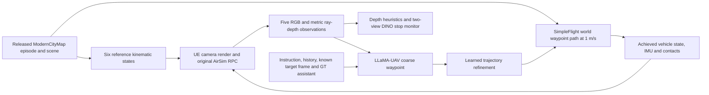

# TravelUAV / OpenUAV: native simulator audit

Evidence date: 2026-10-08. This report separates native integration evidence from AirLab's real-scene fidelity question. Source citations and licenses are in [sources.md](sources.md); original phase-1 material is retained in [phase1-handoff.md](phase1-handoff.md). Measurements are instrumented, single-host smoke tests.

## Decision and scope

Reuse OpenUAV as a possible dynamics/controller host and native visual baseline. A and B have executed. This establishes packaged Linux camera/RPC and short SimpleFlight flight integration. It does not establish real capture import, sparse reconstruction fidelity, novel views at changed altitude, indoor navigation, racing, or real-drone transfer. AirLab's calibrated capture, held-out split and downstream acceptance thresholds were not supplied. The central Real4Real fidelity claim remains untested.

The author project links to `prince687028/TravelUAV`, pinned at `5cc26e9a4a55b9c788e918f7c3bb2dc5076a85e6`. OpenUAV is the UE4/original-AirSim platform; UAV-Need-Help/TravelUAV provides the outdoor dataset and task; LLaMA-UAV is the learned method. These do not count as separate platforms. The earlier `buaa-colalab` repository does not resolve this pinned SHA. IAMAI Project AirSim has a different API. R2R ground navigation is unrelated.

## Experiment flow

A sets kinematics directly and cannot establish controller behavior. B uses one initial reset and one `moveOnPathAsync`, with no per-waypoint teleports. C preserves the authors' segment-by-segment kinematic resets before controller calls, privileged inputs, padding, heuristics and stop rules; it would not be an uninterrupted physical rollout.

## A: six-state replay and calibration evidence

Final replay: [20261008T234631Z-a-18267](../../results/traveluav-openuav/20261008T234631Z-a-18267/). All 30 RGB images and 30 float32 DepthPerspective arrays decoded, dimensions 256×256. All six measured ground-truth vehicle positions matched requested positions exactly at recorded precision. The runner waits for the startup frame and reapplies kinematics while paused. A preceding attempt had a 0.790 m first-pose mismatch and is retained; an earlier corrected-decoder run had 0.049 m mismatch. They are not substituted for the final calibration record.

Five-view order is front, left, right, rear, down. Configured offsets in body NED metres are `(1,0,0)`, `(0,-1,0)`, `(0,1,0)`, `(-1,0,0)`, `(0,0,0)`; respective yaw is 0, −90, +90, 180°, down pitch −90°. Quaternions are `(x,y,z,w)`, world NED axes north/east/down, SI units. Image-response camera poses are authoritative, separate from reference and measured vehicle poses. Configured mounts alone do not substitute for actual camera extrinsics. [Camera-to-vehicle residuals](../../results/traveluav-openuav/20261008T234631Z-a-18267/calibration-validation.json) have maximum translation0.204103m and rotation0.000045°; first-frame actor/camera offset or update lag is possible. Actual extrinsics must be used, not silently replaced by nominal mounts.

Configured horizontal FOV is 90°; API returned 89.903625°. Derived pinhole intrinsics are `fx=fy=128.215484`, `cx=cy=128`, assuming square pixels. These are derived, not calibrated against a physical chart. The API projection horizontal coefficient1 implies128px under a conventional pinhole interpretation,0.215px below FOV-derived128.215; matrix basis and principal point remain a validation caveat. Full API projection matrices are retained. DepthPerspective represents distance along the viewing ray, not optical-axis Z. Raw arrays retain metric floats, finite/invalid/sentinel statistics; previews use one fixed 0–100 m scale. No depth normalization modifies policy inputs.

All ten RGB/depth response timestamps in each final A batch were equal (spread 0 ns). This is observed simulator timestamp agreement while paused, not proof of physical simultaneous exposure. B's moving batches showed nonzero spreads, up to 54.001152 ms.

Final A had first RPC 0.550 s and five later batches averaging 0.182 s, range 0.161–0.195 s. This run overlapped a model loader diagnostic, so its GPU-wide peak is not a scene-only measurement. The earlier scene-only [20261008T230118Z-a-10334](../../results/traveluav-openuav/20261008T230118Z-a-10334/metrics.json) measured 0.173 s mean for **five steady five-view RGB/depth RPC batches**, first 0.544 s, sampled GPU-wide peak 652 MiB. RPC timings include renderer/transport/decoding, exclude later file writes, and do not measure pure rendering or sustained simulation throughput. A client CUDA synchronization cannot synchronize the separate UE process.

## B: corrected controller flight

Final B: [20261008T234423Z-b-17460](../../results/traveluav-openuav/20261008T234423Z-b-17460/). The path RPC completed; final state was captured before pause. The 2 m endpoint threshold no longer terminates or pauses B. C stop rules were not changed.

| Measurement | Corrected B |
| --- | ---: |
| Recorded vehicle/IMU/contact states | 25 |
| Requested state cadence | 0.200 s |
| Achieved intervals, n=24 | mean 0.1993 s; min 0.1836; max 0.2131 |
| State wall / simulator span | 4.7831 / 4.7701 s |
| Endpoint displacement | 4.4385 m |
| Sampled path length, lower bound | 4.4935 m |
| Final requested endpoint error | 0.3939 m |
| Geometric point-to-polyline error | RMSE 0.02554 m; max 0.03503 m |
| Contact-positive samples | 0 of 25 |
| RGB/depth batches | 4 (40 decoded files) |
| RPC first / mean later, n=3 | 0.973 / 0.234 s |
| Sampled GPU-wide peak, scene only | 742 MiB |

Tracking error is the shortest Euclidean distance from each measured 3D position to the requested piecewise linear path: project onto each segment, clamp to segment endpoints, take the minimum; RMSE gives equal weight to each achieved sample. There is no timed reference, so no time-aligned tracking error is asserted. The path is approximately 4.84 m and mostly the first takeoff states; it does not test long-range outdoor navigation. Controller configuration: 1 m/s, ForwardOnly, fixed yaw mode, lookahead 3, adaptive lookahead 1.

Control/RPC completion, motion, and tracking accuracy are reported separately. Contact absence is sampled evidence, not a guarantee of no transient contact. Discrete path length remains a lower bound even after increasing sample density. Independent AirSim clients and worker threads isolate control completion, state/IMU/contact sampling, and image RPC/disk writes; achieved intervals include state RPC and disk overhead. Four image batches have their own timestamps, not one camera sample for every state.

The previous [20261008T230303Z-b-10593](../../results/traveluav-openuav/20261008T230303Z-b-10593/) paused at 1.903 m endpoint error with incomplete RPC and only five states. It is an **incomplete flight**, not completed path execution. Its shorter sampled path and sampled no-contact finding cannot support strong tracking claims. The original slow-decoder B recorded only two states despite RPC completion; it remains historical evidence.

## C: eligibility and pending outcome

Loader diagnostic [20261008T234538Z-c-17859](../../results/traveluav-openuav/20261008T234538Z-c-17859/) passed runtime gates without performing an episode. Full missing/unexpected keys, checkpoint/destination shapes and exact post-conversion tensor comparisons are retained. Non-LoRA has 35 tensors: 23 reach intended parameters exactly; 12 auxiliary `waypoints_predictor`, `is_help_predictor`, `history_predictor` tensors have no corresponding modules in the pinned inference class/forward. The projector file has 365 tensors: 353 reach parameters exactly; the same 12 unused auxiliary names remain. No naming remap, quantization, architecture substitution or trained-byte deletion was performed. Full checkpoint bytes remain verified/retrievable.

Partial missing keys are base/vision/adapter parameters supplied by other loaders, rather than an assertion that every checkpoint should be full. All required newly introduced waypoint/history/embedding heads are covered. LoRA values match exactly after dtype conversion. Trajectory: 520 tensors matched, none missing or different. DINO: 938 matched, two unused entries (`label_enc.weight`, position-id buffer), no missing learned parameters. Shape mismatches and changed values fail eligibility. The pinned QFormer and projector submodule loads are strict; unused EVA final block/norm/classifier entries are logged. Runtime placement and allocator records distinguish Python from UE allocations.

C uses **regenerated episode metadata**. The released map archive contains logs/images/description/mark, not merged_data.json. Authors document generation with their preprocessing script. Its `random.seed = 1` bug was explicitly patched to `random.seed(100)` and the isolated episode generated twice from identical inputs. Both hashes are `997395d41354692e9f13c4ca05b427044b7dfe42ede71acab9bcd3edd108f719`. Runtime metadata hash is `5e137ae9b7112e92e4f259ad16cbbacf5d81794b90dc6db67b6d0f5f77f86f60`; only absolute image-feature path differs from the isolated copy. Description selection and final instruction match. Original published description choice is unknown. [Verification and concrete patch](../../results/traveluav-openuav/20261008T2348Z-metadata-verification/).

Instruction describes a green motorcycle next to a beige building/lamp post and asks the drone to find it, with target yaw −182°. Full exact text is in episode.json and metadata-verification.json. `always_help=True/use_gt=True` remains enabled. Known target position also rotates the input/history coordinate frame, independently of assistant advice. C is therefore assistant-guided, privileged navigation. Five raw RGB arrays feed CLIP-style image preprocessing; front RGB plus model waypoint/state feeds trajectory refinement. Depth clipped to 0–100 m and converted to uint8 feeds collision/guidance logic; two 1024 record views feed DINO stopping. Native padding and requested-waypoint oracle evidence are separated from actual simulator contact and achieved distances.

Released-weight attempt after eligibility is pending settlement here. It is bounded to one episode, batch one, seed 100, at most ten learned decisions; 600 s includes imports/model loading after server startup, server lifetime 900 s. Final outcome will be added from settled evidence. Earlier attempts failed on missing runtime libraries/Numba, explicit key gates, or a byte-string scene name; none produced learned decisions. The server boundary now decodes legacy RPC scene bytes as UTF-8, preserving scene identity and task rules.

## Host, storage and effort

Measured host: Ubuntu 22.04.5 x86-64, one NVIDIA RTX A6000 (49,140 MiB reported), driver 580.126.09, six Xeon 6238R vCPUs, about 47 GiB RAM, 251 GiB disk. This is below the requested CPU/RAM/disk target. Proprietary NVIDIA Vulkan and actual offscreen UE images verify graphics beyond nvidia-smi. Torch is 2.0.1/cu118; the driver's reported maximum CUDA version is not the wheel runtime. Python 3.10 environments are separate for A/B and C, with freezes per run. No driver/security/authentication reconfiguration was used to make rendering work.

Retain the requested engineering allowance for future provision: **A6000 ×1, Ubuntu 22.04, 16 vCPU, 64 GB RAM, 300 GB SSD with NVIDIA graphics/Vulkan access**. It is not a measured minimum. An A10/24 GB is a plausible cheaper single-host inference option only after checking combined peak and available headroom; it is untested. A10 is comfortably above this native scene-only smoke rendering allocation, but complex scenes and policy memory need separate preflight. A40/48 GB and RTX6000 Ada/48 GB are permitted alternatives; A100 CUDA availability alone does not establish graphics support. No other GPU labels are recommended. The paper's eight A100 training GPUs do not imply an inference requirement. Full-instance/storage pricing is unavailable; $0.54/hour is only the user-displayed GPU price.

Selected compressed scene partitions: 18,645,702,495 bytes; ModernCityMap partitions: 9,847,057,165 bytes. Entire archive expansions are 19,576,208,267 and 10,159,691,009 bytes; only the ModernCityDowntown Linux subtree plus shared Engine (2,168,410,072 bytes, 42 files) and selected episode (19,031,427 bytes, 492 files) were extracted. Checkpoint/model files occupy about 22 GiB. Disk was about 79 GiB used / 162 GiB free after setup, including Python/CUDA build dependencies, retained failures and duplicated CUDA component extraction. [Per-file asset manifest](asset_manifest.json) provides actual sizes, revisions, URL/hash provenance and retrievability. Models/data are not committed.

Measured time from initial host verification to first native A was about 37 minutes; loader eligibility was reached about 96 minutes after preflight, including downloads, extension compilation, diagnosis and failed attempts. These are observed elapsed intervals, not clean-install benchmarks. Plan 1–2 hours for this exact first setup and debugging, then about 10–20 minutes for cached A/B plus bounded C and collection; estimates vary with bandwidth/cache and failures. No new policy/scene training occurred.

## Decoder and instrumentation

Both isolated environments load msgpack 1.1.0's `msgpack._cmsgpack`, with a concrete RPC compatibility patch replacing legacy `encoding` arguments while preserving raw/string decoding selection. The same 2,624,104-byte actual ten-response wire payload decoded to equal RGB bytes and float32 depth arrays through old fallback and active decoder. One CPU decode comparison measured 0.492 versus 0.01755 s in A/B (C: 0.497 versus 0.01848 s). These are n=1 decoder timings, not a throughput benchmark. Before/after native RPC evidence is retained; changes also coincide with separate runs, so differences are not a controlled renderer speed comparison.

Instrumentation adds camera-info RPCs, file writes, CUDA synchronization and tensor verification. Model inputs/actions/stops remain pinned; waypoint and input tensors are copied only for logging. First model decision is cold/warmup and later samples are reported separately. GPU-wide samples include all processes; allocator samples cover only Python. They must not be subtracted into an exact policy-only VRAM claim. Video FPS denotes playback only.

## Gaussian observation boundary and R4R relevance

The smallest replacement boundary is Python `AirVLNSimulatorClientTool.getImageResponses` and `getImageResponsesForRecord`, immediately before native image bytes/float depths become NumPy arrays. A packaged binary suffices to retain current state/controller/IMU calls while a future client adapter supplies images; no Unreal editor project is needed for that interface replacement. The adapter is not implemented in this audit.

Supply views at **actual camera** poses and timestamps, not nominal vehicle positions: five H×W×3 uint8 arrays, same raw SDK channel order and row convention (upstream applies no channel/vertical swap), and H×W metric DepthPerspective before the original 0–100 m clip/uint8 conversion. Navigation order front/left/right/rear/down; DINO additionally requires front/down record cameras at 1024². Preserve image preprocessing, frame/history/target inputs, camera intrinsics, pause/resume and clock semantics. RGB/depth pair and multi-view exposure agreement require measurement. Transform NED world poses into a calibrated reconstruction frame with explicit rotation, translation and metric scale. If a Gaussian renderer supplies optical-axis Z, convert to ray distance using intrinsics; invalid/background depth and transparency require an agreed convention.

Native dynamics, collision geometry, nonvisual sensors, target identities/placement and dynamic objects would still come from UE unless separately replaced/aligned. Photoreal splats alone provide none of these contracts. UE collisions against a different real geometry would invalidate physical conclusions. Dynamic cars/vegetation, lighting, unseen surfaces, altitude change and sparse viewpoints require calibrated held-out imagery and explicit coverage tests. Native UE policy success would not validate R4R reconstruction or downstream robustness. A future common-scene/common-camera-route comparison needs corresponding representations of the same real scene, training/held-out split and valid reference images, then image metrics and task outcomes.

Outdoor task/data support is documented and native integration measured. Indoor/racing benchmarks are not released/tested here; arbitrary pose/control APIs may be useful, but this does not establish task coverage. Real-drone research relevance is the instrumentable observation/action interface, not evidence of calibrated real dynamics or transfer.

## Other candidates and human supervision

| Dimension | This stack | Other repository candidates |
| --- | --- | --- |
| Calibrated pose replay | Native pose/RGB/depth measured; actual camera offset caveat | Unreal/Project AirSim plans present; no corresponding artifacts imported into this branch |
| Action/state evolution | Short SimpleFlight B measured | Unknown here; inspect producing branches |
| Real capture import | Not established by packaged binary | Unknown from available results |
| Observation replacement | Client boundary identified from source; unimplemented | Requires candidate API/source audit |
| Collision/dynamics coupling | UE/original AirSim; C segment resets | Project AirSim separate stack; no controlled equivalence |
| Released learned policy | Downloaded and runtime loader gates passed | No comparable policy evidence imported |
| Resources | This exact host/workload measured | Different scene/hardware evidence cannot rank intrinsic speed/realism |

Human learning guide: first understand [host.sh/probe.py](../../simulators/traveluav-openuav/probe.py), then upstream scene server camera settings/ports (`AirVLNSimulatorServerTool.py:15–220,446–539`), client observations/controller (`AirVLNSimulatorClientTool.py:294–427,476–569`), episode schema/split (`env_uav.py:113–158`), model loader/input transform (`travel_util.py:26–52,237–310`), wrapper (`travel_llm.py:7–76`), evaluator state/assist (`eval.py`, `closeloop_util.py:277–309`, `assist.py`), and official `utils/metric.py:27–145`. Links use the pinned revision in sources.md. Review checkpoint gates and regenerated instruction before interpreting C. Use `analyze.py` for decoded-file checks and metric-frame trajectory plots; never infer trajectory from video playback.

## Preservation

All unique outputs, source/config snapshots and generated scientific inputs must be copied to canonical Mac artifacts and verified against settled SHA-256 manifests. Checkpoints/scene partitions may remain remote only with pinned retrieval/hash and accessibility verified independently from the Mac. Final preservation verdict and C outcome are pending completion in this draft. Do not terminate the instance on this draft's authority.
