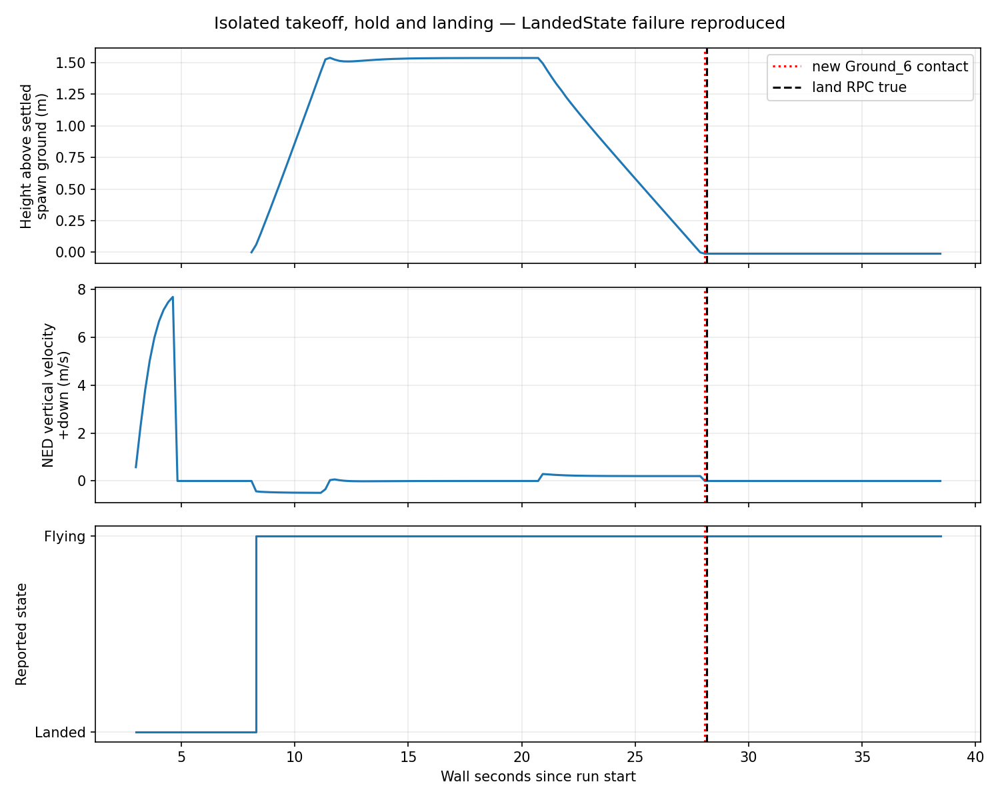

# Focused validation — 8 October 2026

Session started **23:20 UTC / 7:20 PM Indianapolis** with a **23:50 UTC / 7:50 PM deadline** including collection. Existing Ubuntu 22.04.5, RTX A5000, Blocks v1.8.1, UE 5.5.4 and plugin commit `411f879985719ce69eaaf15d58152c551e2719b1` were used. No installs, engine rebuilds, scene/policy training, GPU change or instance termination occurred. All GPU tests ended by 23:29:22 UTC. The original eight-frame replay and every earlier failure remain unchanged.

## Camera sanity: demonstrated

`ue-20261008T232215Z-yaw-6b9a9962` held the ComputerVision rig at NED `(0,0,-2)` m and requested yaw `0,90,180,-90,0` degrees. It records requested poses, actual rig poses, RGB/depth response poses and timestamps, camera-info poses, FOV-derived intrinsics and image/depth SHA-256 hashes. Three RGB warmup calls were discarded and each new pose settled for 0.5 s. No flight dynamics were involved.

All five copied PNGs and depth arrays decoded at 640×480. Capture centers matched exactly; maximum requested-to-RGB quaternion angle error was **0.0000137°**. RGB and depth capture orientations matched, but their timestamps differed by **5.249–8.051 ms**. Fixed poses remove motion during that interval; this does not prove synchronized acquisition during flight. Adjacent distinct yaw images had RGB mean absolute differences **31.29–43.08/255**, with **94.1–99.0%** of pixels differing. Returning to yaw zero produced the same scene composition with mean difference **0.968/255**, rather than an identical hash. Temporal antialiasing/exposure is a possible cause, unmeasured here.

The [copied yaw contact sheet](/Users/srreyanshsethi/Downloads/AL/R4R-Sims/artifacts/unreal/ue-20261008T232215Z-yaw-6b9a9962/yaw-contact.png) was visually inspected: the front wall, side corridors and opposite directions change as expected. The original replay's missing depth timestamps remain missing; new timestamps do not repair old records.

## B: landing-state failure reproduced

Three attempts are preserved separately:

| Run ID | Audited result |
| --- | --- |
| `ue-20261008T232324Z-land-isolated-a3227c9a` | **Rejected despite raw runner `passed`.** Arming occurred during spawn settling; the vehicle never reported Flying or achieved airborne hover. `.join()` discarded the server value. Staying Landed without flight cannot pass this test. Raw records are unchanged. |
| `ue-20261008T232549Z-land-settled-04b41479` | Spawn was allowed to settle. Takeoff reached about 1.51 m clearance and Flying, but `.get()` exposed a **False** takeoff server result. The stricter runner stopped before landing; this is a failed RPC attempt, not a landing test. |
| `ue-20261008T232723Z-land-observed-c1f84706` | **Failure reproduced.** False takeoff RPC retained as a failure, while observed airborne state allowed descent measurement. Hover clearance was 1.51–1.54 m. Landing RPC returned **True**, new `Ground_6` contact occurred, vertical velocity reached zero, and LandedState stayed **Flying** for 10 s afterward. |

The definitive test had **177** state records; descent polling achieved a median **4.912 Hz**, with **no image acquisition and no square route**. Height uses settled spawn `z=0.669971 m` as a ground reference, not the NED origin. Peak downward descent velocity was **0.290 m/s**. New floor contact was observed at **28.068 s**, RPC completion at **28.152 s**, and the final Flying/zero-velocity sample at **38.446 s**. Collision `has_collided` is transient; the timestamp and object are retained after contact. Timestamp comparison alone cannot count every impact between polls.



The earlier square-flight run `ue-20261008T220451Z-b-a3d4be49` likewise ended stationary near `z=0.681541 m` with LandedState Flying after new floor contact. The new run ended near `z=0.681072 m` with the same mismatch. Removing the route and blocking cameras did not remove it. Acceptance was not relaxed: actual airborne state, True takeoff/land server results and five consecutive Landed polls are required for an overall pass. The definitive run failed both the takeoff boolean and LandedState gates.

**Concrete next B hypothesis:** investigate the separate completion predicates. At the pinned source commit, [`MultirotorApiBase.cpp` L48–70](https://github.com/microsoft/AirSim/blob/96235148a332fe7cb3d3525a0720e26faaca99e0/AirLib/src/vehicles/multirotor/api/MultirotorApiBase.cpp#L48-L70) completes `land` after repeated low vertical velocity. [`OffboardApi.hpp` L197–239](https://github.com/microsoft/AirSim/blob/96235148a332fe7cb3d3525a0720e26faaca99e0/AirLib/include/vehicles/multirotor/firmwares/simple_flight/firmware/OffboardApi.hpp#L197-L239) sets Landed only after a throttle threshold and near-zero angular and linear velocities. Next instrumentation should expose those predicate inputs, plus the reason the takeoff RPC returns False despite achieved height. These source conditions explain why the results can differ; they do not identify which condition failed in the released binary. Do not force disarm or rename contact as successful landing.

## S: final-color mesh correction and one splat frame

The preceding control's light at pitch −45°, yaw 0 emitted toward +X/down, while the camera at `(900,0,0)` cm faced the cube's +X side. Epic's [directional-light documentation](https://dev.epicgames.com/documentation/unreal-engine/directional-lights-in-unreal-engine?lang=en-US) describes the arrow as the emitted-light direction; the selected-version [light API](https://dev.epicgames.com/documentation/en-us/unreal-engine/API/Runtime/Engine/Components/ULightComponent/GetDirection?application_version=5.5) and named Rotator convention support this diagnosis. Documentation checked 2026-10-08.

| Run ID | Specific change and outcome |
| --- | --- |
| `ue-20261008T232449Z-s-light-1f298556` | Changed only light yaw **0→180°**, keeping intensity 100000. Final-color mesh became nonblack but visually saturated/bloomed. The initial center/background pixel heuristic allowed one splat frame; subsequent visual inspection rejected the mesh as a usable control. The heuristic and failure remain recorded. |
| `ue-20261008T232833Z-s-light-573e44a0` | Kept yaw 180° and reduced only intensity **100000→10** using the documented light intensity property. A stronger gate required nonblack center, dark background and contrast. The cube's final-color image visibly shows geometry: RGB max **226**, no pixels ≥250, about **16.29%** of pixels above 10. Then exactly **one** splat frame was captured. |

Both use actual editor ticks, `SCS_FINAL_COLOR_LDR`, `RTF_RGBA8`, fixed actual camera `(900,0,0)` cm / yaw180°, 640×480, HFOV60° and assumed `fx=fy=554.256 px`. Pose records, capture-request times, export-completion times and hashes are saved. Neither timestamp is a measured exposure instant. Each launcher had a 240 s watchdog; no black-frame route was launched.

The final [cube image](/Users/srreyanshsethi/Downloads/AL/R4R-Sims/artifacts/unreal/ue-20261008T232833Z-s-light-573e44a0/cube_final.png) and [single splat image](/Users/srreyanshsethi/Downloads/AL/R4R-Sims/artifacts/unreal/ue-20261008T232833Z-s-light-573e44a0/splat_final.png) were opened locally. The splat has visible dark red detail, RGB max **113**, and **0.322%** of pixels above 10. This demonstrates narrow imported-splat final-color export. Its dark appearance, coverage and correctness remain unvalidated; it is not an outdoor reconstruction or fidelity result.

**Concrete next S hypothesis:** inspect the selected importer/material color path before changing routes. [`GaussianSplattingPointCloud.cpp` L204–216](https://github.com/Italink/GaussianSplattingForUnrealEngine/blob/411f879985719ce69eaaf15d58152c551e2719b1/Source/GaussianSplattingRuntime/Private/GaussianSplattingPointCloud.cpp#L204-L216) gathers/validates optional higher-order SH indices, but [L263–271](https://github.com/Italink/GaussianSplattingForUnrealEngine/blob/411f879985719ce69eaaf15d58152c551e2719b1/Source/GaussianSplattingRuntime/Private/GaussianSplattingPointCloud.cpp#L263-L271) stores DC color after sRGB-to-linear conversion. The [point structure L18–55](https://github.com/Italink/GaussianSplattingForUnrealEngine/blob/411f879985719ce69eaaf15d58152c551e2719b1/Source/GaussianSplattingRuntime/Public/GaussianSplattingPointCloud.h#L18-L55) has one color and no higher-order SH storage. Those coefficients are not retained by this import path. A next test should inspect the Niagara material's shading/exposure and compare expected imported DC color against a reference for this **same PLY and camera**. No such calibrated reference was supplied. Source color loss is a material R4R limitation even though one frame exports.

## Preservation and exact continuation

All six new run directories are local at `/Users/srreyanshsethi/Downloads/AL/R4R-Sims/artifacts/unreal/<run-id>/`. **89 files / 10,289,430 bytes** matched VM-created source size/SHA-256 manifests. All copied new RGB/depth/control outputs were decoded and relevant figures visually inspected. Summary and plot are at `results/unreal/focused-validation-20261008T232000Z/`, with their own VM-created source manifest. A first S transfer exposed a changing `render.log` after editor exit; both S initial manifests were preserved as `source-manifest-at-process-exit.json`, then recreated after the trace writer ended and verified locally. No mismatch remains. The first S and settled B process lifetimes briefly overlapped; no isolated GPU performance metric is claimed.

No further GPU execution is needed to preserve this session. Existing editor/sample ZIPs, compiled plugin and imported project assets remain locally preserved as listed in [assets.md](assets.md). This session's Blocks/editor processes have exited; the instance remains running. Shutdown readiness concerns evidence preservation only, not scientific completion. The R4R real capture, calibrated held-out split, useful splat observations, splat depth/collision and compatible learned policy remain unresolved.

For a specifically justified future B run on this host (not an automatic repeat), use a fresh ID:

```bash
cd /root/R4R-Sims-unreal-audit
RID="ue-$(date -u +%Y%m%dT%H%M%SZ)-land-$(python3 -c 'import uuid;print(uuid.uuid4().hex[:8])')"
timeout -k 15 160 /root/R4R-Sims/third_party/unreal/venv/bin/python \
  simulators/unreal/focused_validation.py landing --run-id "$RID"
status=$?
python3 simulators/unreal/manifest.py create "artifacts/unreal/$RID"
exit "$status"
```

S exact launch commands and script versions are preserved in each S run's `launch-runner.sh` and `control-script.py`. Do not rerun them unchanged. The analysis can be regenerated with the existing remote `analysis-venv` using `simulators/unreal/focused_analyze.py --artifacts-root artifacts/unreal --output results/unreal/focused-validation-20261008T232000Z`; raw evidence stays immutable.
