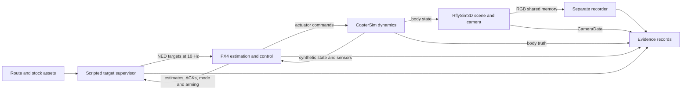
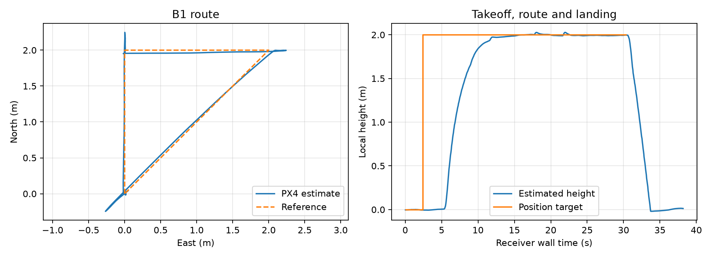
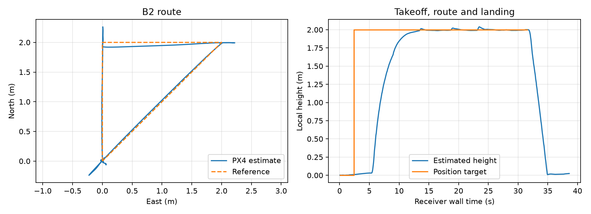
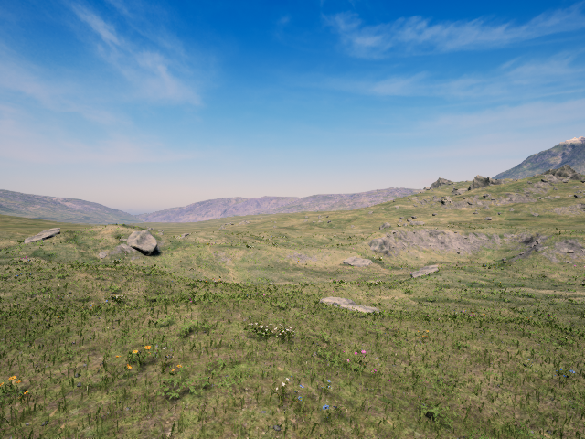

# RflySim measured evaluation and component handoff

Measured 10 October 2026; offline handoff revised 11 October. Executed baseline `7188f4d`, preserved evaluation commit `9749a40`. This revision interprets existing evidence and makes review media. **No new Windows session or simulator run. AirGPU stays Off.** [Offline provenance and output navigator](../handoff-20261011T220420Z/README.md).

## Component-level decision

**Reuse PX4/CopterSim for stock motion/control integration. Keep RflySim3D as a working native visual baseline.** Two closed-loop waypoint flights completed using PX4 estimates and the second recorded RGB concurrently. RflySim need not implement all of Real4Real to be useful. An unattended harness and a pretrained visual policy are not requirements for these component decisions.

| R4R role | Verdict and evidence | Remaining condition |
|---|---|---|
| PX4/CopterSim dynamics/control host | **Demonstrated: reuse for bounded SITL integration.** B1/B2 minimum and full-route passes. | Stock physical model has no real-drone calibration. Simulator-truth frame/clock mapping needs verification for metric motion export. |
| Native RflySim3D visual baseline | **Demonstrated: keep.** Stock Grasslands, one Free RGB camera, 640×480, approximately 10 Hz delivered records. | Geometric use of native images needs native calibration; basic visual inspection does not. |
| Motion exported to an existing Gaussian renderer | **Proposed: small adapter for offline replay.** State and body truth already export. | Verify chosen state frame/origin/scale, supply external scene and renderer. The external renderer may define its own camera intrinsics/extrinsics and render clock. This architecture does not inherently need native UE camera calibration. |
| Reconstructed mesh through UE | **Documented import route; selected-build Free eligibility unresolved.** Cooked UE asset + XML MeshPath/Scale. | Validate actual loader and permitted custom scenes. No real reconstruction entered this test. |
| Native calibrated camera replay | **Incomplete.** Translation and CameraData interfaces work, images preserved. | Correct our angle/duration defect, verify projection/extrinsics and acquisition association before 0.02 m / 1° and feature checks. |
| Native direct photo+pose / Gaussian reconstruction renderer | **Unresolved.** No supported direct reconstruction/Gaussian loader established. | Vendor/installed loader and edition eligibility. A stock RGB demo cannot establish outdoor novel-view fidelity. |
| External renderer feeding a visual controller | **Proposed: substantial integration.** Commands and observations are separate reusable interfaces. | Observation/action adapter, scheduling, reset/time ownership and selected task. Native injection contract unresolved. A chosen controller may be classical or learned. |
| Released learned policy experiment C | **Blocked and outside the demonstrated path.** No compatible released weights/task/adapter. | This blocks C, not component reuse. |

## Actual inputs and their meanings

| Input | Selected, evidenced identity | What it is |
|---|---|---|
| Distribution | Free `RflySimToolchain-v5.01-20260831.iso`, 23,151,480,832 B, SHA256 `ed5f41add2e97469c900f4ccff87f615eae4e7cfbedcc7d99211afd4d5dc7973` | Installer/software package, vendor terms and edition restrictions. Complete file on stopped Windows disk. Truncated Mac original preserved and never installed. |
| Components | CopterSim Free 5.0.1, RflySim3D Free 5.01-0 / UE4.27.2-18319896, bundled PX4 1.12.3dev | Installed binary identities, separate from author repository HEAD. Canonical SDK hashes in [assets](assets.json). |
| PX4 firmware | B1 ULog `ver_sw=a301969dc209c166b9fbbb524bd51ca1ece76b04`, branch master, release fields 1.12.3/type 0 | Firmware identifier. No claim that build tree was unmodified. [Offline native-log summary](../handoff-20261011T220420Z/native-log-summary.json). |
| Vehicle | CopterSim model 0 + `10016_iris`, one quadcopter | Simulated dynamics/airframe configuration, not a learned checkpoint. Complete physical model/DLL parameters remain unknown. |
| Scene | Grasslands `/Game/Grasslands/Maps/Grasslands/3DDisplay` | Stock rendered world. No AirLab real capture or train/test split. Scene asset hash inventory incomplete. |
| Controller | Authored scripted target supervisor + PX4 estimate feedback/control | Targets, freshness and dwell logic. No learned weights. |
| B targets | Origin → (0, 0, -2) → (2, 0, -2) → (2, 2, -2) → (0, 0, -2) → land | PX4 local NED metres, yaw 0 radians. [Frozen B1](B1/freeze.json), [B2](B2/freeze.json), copied configs. |
| Camera | One Type 1 RGB, Seq 0, vehicle 1, 640×480, requested 10 Hz, FOV 90° | B mount 0 requested FRD (0.3, 0, 0) m, zero attitude; A mount 2 world-fixed. FOV axis/projection and achieved body-camera transform unverified. |
| A reference | p0(0, 0, -2), p1(1, 0, -2), p2(0, 1, -2), p3(0, 0, -3), p4(0, 0, -2)/yaw 15°, p5(0, 0, -2)/pitch 10°, p6=p0 | Desired camera centres/angles. A used provisional map ground Z −8.05 m. Our executed degree conversion made p4/p5 rotations invalid. |
| Host | Windows Server 2025 Datacenter build 26100, L4 driver 596.86 / 23,034 MiB, 8 logical CPUs / 4 EPYC7R13 cores, 32 GB RAM, 400 GB SSD | Tested hardware/session, WSL1 RflySim-20.04. Displayed compute $1.95/hour; total charges/expanded disk footprint unknown. |
| Backup “checkpoints” | Three evidence ZIPs | Recovery archives, not ML checkpoints or scientific scene inputs. |

No real reconstruction, training dataset, learned policy, downstream model or fidelity threshold was used. The precompiled stock path needed no licensed MATLAB/Simulink model generation or Unreal editor. Windows 10/11 is documented by the vendor; this particular Server 2025 host worked empirically. No complete Free Linux visual-camera path has been established.

## Component roles and actual operation



The supervisor streams a position target, waits for fresh estimated position to stay within the frozen tolerance, then advances the leg. PX4 estimates vehicle motion from simulated sensor/state input. Conceptually its multicopter stack uses position feedback to request velocity, velocity feedback to request acceleration/thrust, attitude control and rate control to produce actuator commands. CopterSim integrates vehicle motion; RflySim3D uses that motion to render the stock camera. The independent recorder copies pixels and writes PNG/metadata. **Images never drive this waypoint controller.** This is a state-feedback loop with concurrent observations, not vision-driven navigation.

PX4's documented v1.12 stack uses EKF2 and cascaded P/PID loops. B1's recovered `SYS_MC_EST_GROUP=2`, estimator topics and controller parameters are consistent with that configuration. This is a conceptual explanation, not independent validation of every internal signal. Full CopterSim physical coefficients, actuator/noise calibration and proprietary implementation remain unknown. [PX4 controller diagrams](https://docs.px4.io/v1.12/en/flight_stack/controller_diagrams), [estimation guide](https://docs.px4.io/v1.12/en/advanced_config/tuning_the_ecl_ekf), accessed 2026-10-11.

[Installed interface guide](../../../docs/rflysim/installed-execution.md) gives owners, SDK file/line references and clocks: control UDP 20100/20101, SITL TCP 4560, truth UDP 30101/multiplex, native CameraData UDP 20006 and `RflySim3DImg_0` named shared memory. Truth/map, PX4 local NED, camera metadata and image clock remain distinct.

## What ran end to end

| Test | Measured outcome | Basis/limitation |
|---|---|---|
| B1 capture off | **Minimum integration PASS; full route PASS.** 38.750 s supervised, flight worker exit 0. Takeoff, all 4 legs, landing and disarming confirmed. | Fresh PX4 estimates/heartbeat/landed state. Independent truth criterion blocked. |
| B2 capture on | **Minimum integration PASS; full route PASS.** 39.219 s supervised, flight worker exit 0,365 RGB frames. | Same prescribed route after audit-owned stock reset. Frame-to-acquisition pose unverified. |
| A1 |260 frames, worker capture 25.797 s, short 26 s contract | **Authored angle conversion failed.** Geometric A incomplete. |
| A2 |261 frames, worker capture 26 s | **Authored angle conversion failed.** Desired 15°/10° did not execute. |
| Rate |351 frames /35 s including 5 s warmup; 300 post-warmup, 10.013 Hz delivered record rate | No duplicate native timestamps/post-warmup receipt gap>150 ms. Acquisition latency unknown. |
| Coupled B2 | Commands, modes, estimates, body truth, camera metadata and RGB coexist in one flight | **Concurrent recording demonstrated. Calibrated observation association blocked.** |
| C |No episode run |Compatible released policy path absent. |

Criteria remain unchanged: B position error ≤0.25 m continuously sampled 2 s, 12 s/leg, 10 Hz targets, 0.5 s freshness, 75 s flight +15 s separate cleanup. Takeoff requires fresh armed state and ≥1 m above initial ground for 1 s. Touchdown requires fresh ON_GROUND and speed ≤0.2 m/s for 2 s, plus confirmed disarming. Each leg has offline 41-position/2 s dwell corroboration. [Dwell records](dwell-corroboration.json). These are estimate-based passes.




Both cleanup evaluators returned landing/disarm confirmations but workers stayed alive until the 15 s deadline, exit−15. Raw cleanup files are empty. Flight records independently retain landing evidence. Local queue/exit corrections are untested on Windows, so the **harness lifecycle** remains unreliable while the flight-level passes remain supported.

## Worked command/state/frame example

[New offline trace](../handoff-20261011T220420Z/worked-example.json), B2 frame 182, preserves exact clocks and sources. Latest preceding target (2, 2, −2) m is at receiver UTC 1791674187.6818573. Nearby PX4 estimate (1.985245, 1.743410, −1.998638) m, boot 233896 ms, arrives at UTC 1791674187.7543566. The preceding heartbeat reports OFFBOARD and armed. Earlier command 176 (mode) and 400 (arm) ACKs report result 0. Position-target streaming has no per-target COMMAND_ACK; command 512 ACKs acknowledge telemetry requests.

Native body record has raw clock 239.405 and map position (2.035290, 1.695162, −10.041548). Native camera has raw clock 239.392 and position (2.334858, 1.683849, −10.193274). Frame 182 has raw image clock 239.352, receiver UTC 1791674187.7698567 and SHA256 `be45e6ef227cf1dd4967568796e25c484c920cbcbb1c3536b20e930d79983e5b`. **This receiver-near trace illustrates the interfaces. It does not establish that camera pose at acquisition.** Acquisition UTC, acquisition-pose and association uncertainty remain null. The original trace is retained; its nearest command 512 ACK must not be read as waypoint acceptance.



## Output inventory and playable review media

The [review index](../handoff-20261011T220420Z/README.md) and [machine-readable output inventory](../handoff-20261011T220420Z/outputs.json) identify exact Mac paths, bytes, hashes, archive entries and meanings for flight records, frame sequences, derived plots, native ULog and media.

| Sequence | Native PNGs | Capture/record span | Playable video |
|---|---:|---|---|
| A1 |260 |25.797 s worker; 25.766 s first-to-last receipt |[A1 invalid rotations + short capture](https://drive.google.com/file/d/1ibOwVslVGmisP9X8UwDgCizux6ipR5fz/view), 26.0 s playback |
| A2 |261 |26 s worker; 25.984 s receipt span |[A2 invalid rotations](https://drive.google.com/file/d/17zO7RcjxzS9Di2hQ6bunKNpjBWCwzgqw/view), 26.1 s playback |
| B2 mounted |365 |36.359 s receipt span inside 39.219 s supervised flight |[B2 concurrent RGB](https://drive.google.com/file/d/1Oo4rKyNAbzIcOHF5U3Kjt43WKq89NAOd/view), 36.5 s playback |
| Rate |351 |35 s worker, 5 s warmup +30 s test |PNG/metadata/rate plot in main raw archive; no extra video required |

Videos use every saved frame in ordinal order at constant 10 FPS, including warmup. A 40 px caption beneath native 640×480 produces 640×520 review H264 with no audio. Playback 26.0 s does **not** convert A1's25.797 s capture into a pass. Acquisition timestamps do not control playback. Full decoded counts equal source counts; midpoint images inspected. Native lossless PNGs remain scientific evidence. Drive byte/SHA256 download checks match the Mac videos and sharing remains private.

B1/B2 raw flight records contain20,050/20, 280entries and derived764/772position estimates and3798/3842multiplex truth records. B2 camera stream contains 1,734 CameraData and 1,850 body truth packets. Original archive manifests cover all 1,237 PNG files. The 51,318,508 B B1 ULog spans 946.224 s of startup plus flight, not a 946 s route. Offline parsing recovers 660 initial parameters, 11 changes, firmware identity, zero dropout records and no corruption flag. [Parameters](../handoff-20261011T220420Z/B1-px4-parameters.json). Early startup changed `COM_RCL_EXCEPT=4`, `NAV_DLL_ACT=0`, `NAV_RCL_ACT=0` at 4.304 s, well before B1 around PX4 boot 909 s. Our adapter avoided autoarming/failsafe-changing helpers; the effective stock setup nevertheless used these failsafe settings. Responsible launcher/configuration source is unresolved. Do not copy these settings into real flight.

## Timing, resources and their coverage

| Measurement | B1 off | B2 on |
|---|---:|---:|
| Setpoint mean/max interval |100.022/109 ms |100.034/110 ms |
| Maximum tick lateness |12 ms |16 ms |
| Ticks late>10 ms / total |56/280 |116/292 |
| Ticks late>100 ms |0 |0 |
| Maximum position receipt gap |125 ms |110 ms |
| PX4 boot-clock recorded span |38.148 s |38.549 s |
| Whole-window GPU peak allocation |1761 MiB |1758 MiB |
| Whole-window mean/peak utilization |16.93%/24% |17.47%/26% |

[Timing](B2/tracking-timing.png), [coverage](resource-coverage.json), [metrics](metrics.json). Two sequential flights do not isolate capture overhead. GPU 100 samples per run at ~1.05 s intervals include desktop/Moonlight/preflight. B1 covers flight; inferred UTC−04 association gives only ~21.65 s B2 overlap and misses landing. No renderer-only throughput, GPU synchronized kernel time, policy latency or minimum VRAM is established. Playback FPS is separate. Partial process working-set maxima: CopterSim 88,899,584 B, UE engine 624,463,872 B, wrapper 7,700,480 B. No total RAM/CPU utilization or per-sample CPU clocks. L4 was sufficient for this measured stock workload; no larger card or cheaper complete Linux platform is justified here.

Receiver-nearest truth comparison with a fitted initial offset gives mean estimate disagreement 0.0196 m / 0.0181 m. This remains a timing/frame diagnostic, not independently calibrated truth accuracy. Full installation footprint, free space and total storage/tax charges were not exported.

## Issues, ownership and consequence

| Issue | Ownership/status | Consequence for reuse |
|---|---|---|
| Radians sent to a degree camera field |**Confirmed authored defect.** Intended 15°/10° became~0.262°/~0.172°. Local fix not host retested. |Blocks A intended-angle result. Does not invalidate B/nativeRGB or an external renderer using its own camera. |
| A1 capture 25.797 s |**Authored duration accounting defect.** Local fix, untested remotely. Windows strict-duration retest raw missing and still used wrong angles. |Blocks strict A1 duration result. Duration-only retest is not a corrected-angle test. |
| Camera−body initial raw (0.3, 0, −0.15) m vs requested (0.3, 0, 0) m |**Unresolved frame/model/actor-origin hypothesis.** [Diagnostic](mount-diagnostic.json). |Blocks treating desired mount as achieved native extrinsics. External motion export still needs its chosen state-origin mapping. |
| FOV axis, optical frame, projection, orientation/color/distortion |**Installed interface semantics partially documented, independently unverified.** |Blocks native projection feature criterion and calibrated comparison. Not every external-renderer path needs these native-camera values. |
| Acquisition clock and initial A2 jump |**Unresolved.** Receiver time follows encoding; distinct raw clocks preserved. |Blocks acquisition-time native pose association and latency. Offline external replay may own its own time. |
| Cleanup summary but −15 worker/empty logs |**Authored lifecycle/evidence issue, cause unresolved.** Fresh-queue correction local only. |Blocks unattended harness reliability/full cleanup log claim. Does not erase retained flight landing evidence or require rejection of the components. |
| Renderer prerequisite/system32 assert |**Platform/setup issue.** Bundled Epic prerequisite installed with exit 0; correct-CWD retest launched L4. Initial assertion cause unresolved. |Setup requirement recorded. Renderer subsequently worked. |
| Stale telemetry before B2 |**Setup/lifecycle issue.** Probes 6–9 failed, audit-owned stock/WSL reset then probe 10 + B2 succeeded. Root cause unresolved. |Reset/freshness prerequisite. No automatic global process kill. |
| GPU/CPU coverage |**Authored sampling limits.** B2 partial, process RAM lacks sample timestamps. |Blocks renderer-only performance/minimum resources and causal overhead claims. |
| Missing final files |**Preservation gap.** Main scientific records durable; final transcript/B2 ULog/retest/inventory still stopped-host-only. |Limits detailed reproducibility and native B2-log corroboration. Existing B2 raw telemetry supports reported passes. |
| Missing real scene/calibration/held-out views/downstream task |**Research inputs absent.** |Blocks fidelity, altitude extrapolation and downstream utility measurement. No stock-image PSNR/SSIM/LPIPS or transfer claim. |

[Detailed historical failures and repairs](failures.md), [executed hashes](executed-code-provenance.json). Later corrected adapters are distinct from executed source. Twenty-five synthetic helper tests are local verification, not simulator validation.

## R4R architectures and applicability

**Native baseline:** stock renderer and motion integration are demonstrated. Residential/suburban/campus reconstructions below 100 m, indoor tasks and racing are not evaluated. Sparse image coverage tests unseen surfaces/view extrapolation; sparse physical scene content tests available perceptual/obstacle structure. Vegetation, moving objects and lighting need separate experiments.

**External offline renderer:** use recorded chosen body motion, verify metric world origin/scale/orientation, define a camera in the external renderer and render an already supplied Gaussian scene. A small replay adapter is plausible. UE CameraData/K need not participate. For correspondence to native/real cameras, calibrate the relevant camera and scene transform. This pass implements no renderer.

**Reconstructed mesh:** [official import documentation](https://rflysim.com/doc/en/4.DevRef/3d-import.html), checked 2026-10-11, describes cooked UE FBX/OBJ+XML MeshPath/Scale. Installed closed loader and Free arbitrary-map eligibility remain unresolved. Neither a format mention nor public CopterSim code proves a complete free visual rebuild. Photos+poses and native Gaussians have no verified direct path.

**External visual loop:** send external-rendered observations directly to a chosen controller, then its commands to PX4/CopterSim. This could bypass native image injection. Scheduling, state/observation synchronization, reset and action/observation contracts require substantial integration. Depth/collisions need owners only when the chosen task requires them. Pure trajectory RGB replay does not inherently need collisions. Gaussian radiance alone does not supply contact geometry. Native UE replacement/injection remains unresolved; `sendImgBuffer` forwards images to consumers.

Missing research assets are real images, pose/intrinsic calibration, metric reconstruction, split/held-out horizontal and vertical views, chosen downstream model and approved fidelity thresholds. These block broader R4R evaluation, not evidence that reusable control/render interfaces work. No unmatched simulator ranking.

## Preservation and next action

Exact outputs/archives are in [offline navigator](../handoff-20261011T220420Z/README.md). Local ZIP SHA256/internal manifests and all 1,237 native PNG openings verified again 11 October. Three new videos fully decode and Drive roundtrip hashes match. Existing review ZIP remains a historical snapshot. Original report/deck/PDF are preserved in Git 9749a40 and an ignored `handoff.../before` snapshot. Executed records/source/configs are unchanged.

Missing: final transcript, B2 ULog, strict-duration A1 retest files, final scene/model/launcher hashes, B2 parameters. B1's 660 parameters are now recovered offline. Complete verified ISO stays on stopped Windows disk with official URL/hash, not a complete Mac copy.

[Smallest justified Windows follow-up](../../../docs/rflysim/minimal-followup.md) separates recovery from architecture-dependent measurements. **No restart is needed to judge or review the demonstrated component usefulness.** An optional ~15–20 min recovery-only session would fill missing files; corrected/calibrated native A needs additional bounded measurements only if that role is selected. Preserve numerical criteria and avoid repeating passed B automatically.

[Editable deck](rflysim-evaluation.pptx) and [matching PDF](rflysim-evaluation.pdf) cover components, results, media, issues and decisions. [Sources](../../../docs/rflysim/sources.md). Local analysis/review reproduction:

```sh
python3.12 -m venv /tmp/r4r-rflysim-analysis
/tmp/r4r-rflysim-analysis/bin/pip install -r simulators/rflysim/analysis-requirements.txt -r simulators/rflysim/review-requirements.txt
MPLCONFIGDIR=/tmp/r4r-rflysim-mpl /tmp/r4r-rflysim-analysis/bin/python simulators/rflysim/analyze_evidence.py --input artifacts/rflysim/eval-20261010T215531Z/raw --output /tmp/r4r-rflysim-reanalysis
/tmp/r4r-rflysim-analysis/bin/python simulators/rflysim/inspect-native-log.py --input artifacts/rflysim/eval-20261010T215531Z/raw/B1-native.ulg --output /tmp/r4r-rflysim-native-log
/tmp/r4r-rflysim-analysis/bin/python simulators/rflysim/build-review-media.py --input artifacts/rflysim/eval-20261010T215531Z/raw --output /tmp/r4r-rflysim-videos --manifest /tmp/r4r-rflysim-videos.json
```

No Mac simulator installation. Analysis dependencies are isolated. Windows installed environment inventory remains incomplete. Host remains Off and no permissions/sharing changed.
