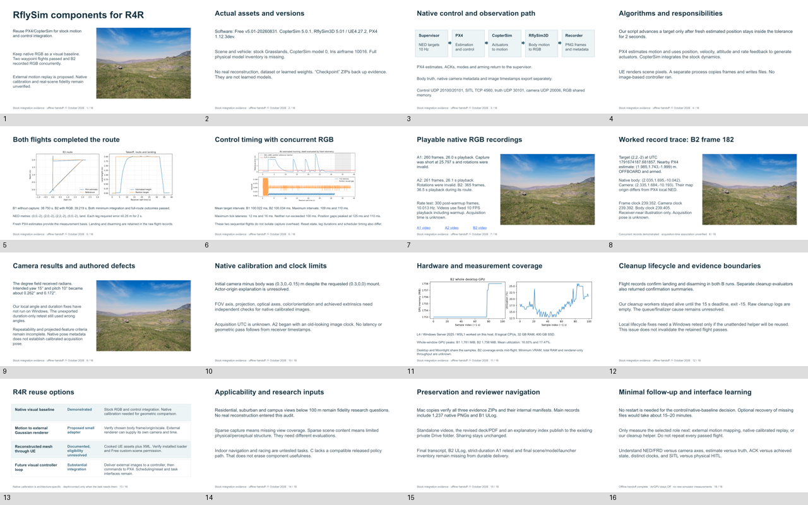

# RflySim evidence navigator and component handoff

Offline revision: 11 October 2026. Measured source: 10 October, `eval-20261010T215531Z`. Branch `audit/rflysim`, source commit `9749a40` (authored handoff revision is in Git history). **No new simulator run. AirGPU kept Off.**

## Review first

- [Editable component deck](https://drive.google.com/file/d/1rq5bF_duuOar6tTBW6jEw1H80SWGHvNh/view) — 16 slides, actual imagery, measured B2 trajectory/timing/resources, worked frame-182 trace and clickable videos.
- [Matching deck PDF](https://drive.google.com/file/d/1Yu01hS3wXT5UcZVLmbo50eTaBSTEc4Na/view) — same slides, playable-video links on page 7.
- [Detailed measured report](../eval-20261010T215531Z/README.md) and [installed interface guide](../../../docs/rflysim/installed-execution.md).
- [Exact file inventory](outputs.json), [source verification](local-source-verification.json), [publication checks](drive-publication.json), [minimal future follow-up](../../../docs/rflysim/minimal-followup.md).
- [Existing private audit folder](https://drive.google.com/drive/folders/1IN_s-iaT37Wn2MItsYK9U0GtgRRiTDwn). Sharing permissions are unchanged.

Drive text copies: [detailed report](https://drive.google.com/file/d/1kV2-EfonGMjSDnTOeD3iz5gTdjsI4D8t/view), [installed interfaces](https://drive.google.com/file/d/1lfng17tExXTid_FwFgg5gPmgWykm9BVU/view?usp=drivesdk), [minimal follow-up](https://drive.google.com/file/d/1uGFgrto9o2xs65G65AxfAsDkkE8_6hDh/view?usp=drivesdk), [exact inventory](https://drive.google.com/file/d/1TYVC7TUT1ObIovx-qpRDGN9VZj31v8il/view) and [linked index PDF](https://drive.google.com/file/d/1VNqpPpE-x0YsFSlX2qcwq6DjxJaQaVOU/view). Relative links below target this repository; these Drive links work independently.

**Decision:** reuse PX4/CopterSim for stock motion/control integration and retain native RGB as a visual baseline. External motion replay through an existing Gaussian renderer is a proposed small adapter after state-frame mapping. That renderer may define its own camera/time. Native calibrated replay remains incomplete; direct Gaussian/photo reconstruction import is unresolved; UE mesh import is documented but Free build eligibility is unverified. A future external visual loop needs substantial integration. No real capture, learned weights or training dataset was used.

## Results and videos

| Evidence | Outcome | Review link and playback |
|---|---|---|
| B1, capture off | Minimum and full route PASS, fresh PX4 estimates, landing/disarm, 38.750 s supervised. | [B1 trajectory](../eval-20261010T215531Z/B1/trajectory.png) |
| B2, capture on | Minimum and full route PASS, fresh PX4 estimates, landing/disarm, 39.219 s supervised. RGB did not drive control. | [B2 video](https://drive.google.com/file/d/1Oo4rKyNAbzIcOHF5U3Kjt43WKq89NAOd/view?usp=drivesdk), 365 frames / 36.5 s playback |
| A1 | Native RGB available. Invalid intended rotations and 25.797 s capture below 26 s contract. | [A1 video](https://drive.google.com/file/d/1ibOwVslVGmisP9X8UwDgCizux6ipR5fz/view?usp=drivesdk), 260 frames / 26.0 s playback |
| A2 | Native RGB available. Invalid intended rotations. 26 s worker capture. | [A2 video](https://drive.google.com/file/d/17zO7RcjxzS9Di2hQ6bunKNpjBWCwzgqw/view?usp=drivesdk), 261 frames / 26.1 s playback |
| Rate | 351 frames over 35 s including warmup, 300 post-warmup, 10.013 Hz delivered record rate. | [Rate plot](../eval-20261010T215531Z/rate/capture-timing.png) |
| Coupled capture | B2 state/body/camera/frame records concurrent. Acquisition-time camera association unverified. | [Worked trace](worked-example.json) |
| C | No compatible released learned policy path. No episode executed. | Not required for component usefulness. |

Each MP4 contains all saved source frames, including warmup, in ordinal order at fixed 10 FPS. No acquisition timestamps determine playback. A 40 px warning caption below the original 640×480 image gives a 640×520 review video, H264/yuv420p/no audio. A1's 26 s playback does not repair its short capture. Full video decode counts match 260/261/365. Native PNGs remain the lossless evidence.

## Archive contents without guesswork

| Durable Drive file | Exact contents needed for this review | Local copy |
|---|---|---|
| [Checkpoint 1](https://drive.google.com/file/d/12vwXN78oDds6PJtA3n-HIU3lQpt-01eo/view) | Renderer logs, prerequisite/process record, stock stdout/stderr, probes 1–2, executed early code. | `/Users/srreyanshsethi/Downloads/AL/R4R-Sims-rflysim/artifacts/rflysim/eval-20261010T215531Z/rflysim-checkpoint1.zip` |
| [Checkpoint 2](https://drive.google.com/file/d/1i0qA2trimS9E4R9gID_j6DkTtMviIHX1/view) | `B1\flight.jsonl`, `B1\run.json`, `B1\freeze.json`, `B1\config.json`, empty `B1\cleanup.jsonl`; B1 stdout/stderr/GPU/resource records, probes 3–5, executed control source. | `/Users/srreyanshsethi/Downloads/AL/R4R-Sims-rflysim/artifacts/rflysim/eval-20261010T215531Z/rflysim-checkpoint2.zip` |
| [Main raw archive](https://drive.google.com/file/d/1gydzS0cL8c635wACELIjVgf0HonZr6sa/view) | `B2\flight.jsonl` + run/config/freeze/empty cleanup; `B2\rgb\camera.jsonl` + 365 frames; `A1\camera.jsonl` + 260 frames; `A2\camera.jsonl` + 261 frames; `rate\camera.jsonl` + 351 frames; `B1-native.ulg`, probes 6–10, reset records and immutable `code-v2`. | `/Users/srreyanshsethi/Downloads/AL/R4R-Sims-rflysim/artifacts/rflysim/eval-20261010T215531Z/checkpoint3.zip` |
| [Original review bundle](https://drive.google.com/file/d/15NTapOy57r11r-x6CRLq9IsDPuL7oVl6/view) | Historical 10 October report/deck, selected raw telemetry, plots/previews/code/manifests. The standalone revised deck/PDF/index above supersede its narrative. | `/Users/srreyanshsethi/Downloads/AL/R4R-Sims-rflysim/results/rflysim/eval-20261010T215531Z/rflysim-review.zip` |

ZIP entry names use Windows backslashes. Verified extracted evidence is normalized under `/Users/srreyanshsethi/Downloads/AL/R4R-Sims-rflysim/artifacts/rflysim/eval-20261010T215531Z/raw`. The main archive is 651,522,799 B, SHA256 `d601dc38134b20d1287b0d14e991abb3120b9212795eca4517959cde548fb6d2`. The original review bundle is 13,439,685 B, SHA256 `a5718698cc281068a8ac0daa7abceae2c4f0ba098c2f29ce8fdc4d0dd708c8a4`.

## Exact Mac locations and meanings

| Output | Exact location / count / meaning |
|---|---|
| B1 raw record | [/Users/srreyanshsethi/Downloads/AL/R4R-Sims-rflysim/artifacts/rflysim/eval-20261010T215531Z/raw/B1/flight.jsonl](/Users/srreyanshsethi/Downloads/AL/R4R-Sims-rflysim/artifacts/rflysim/eval-20261010T215531Z/raw/B1/flight.jsonl) — 20,050 raw entries. |
| B2 raw record | [/Users/srreyanshsethi/Downloads/AL/R4R-Sims-rflysim/artifacts/rflysim/eval-20261010T215531Z/raw/B2/flight.jsonl](/Users/srreyanshsethi/Downloads/AL/R4R-Sims-rflysim/artifacts/rflysim/eval-20261010T215531Z/raw/B2/flight.jsonl) — 20,280 raw entries. |
| Derived flight records/plots | `/Users/srreyanshsethi/Downloads/AL/R4R-Sims-rflysim/results/rflysim/eval-20261010T215531Z/B1/` and `/Users/srreyanshsethi/Downloads/AL/R4R-Sims-rflysim/results/rflysim/eval-20261010T215531Z/B2/`: actions, estimates (764/772), ACK/mode/arming/landed state, multiplex truth (3,798/3,842), trajectory, tracking/timing, truth diagnostic and GPU plots. |
| Native flight log | `/Users/srreyanshsethi/Downloads/AL/R4R-Sims-rflysim/artifacts/rflysim/eval-20261010T215531Z/raw/B1-native.ulg` — 51,318,508 B, 946.224 s startup plus flight; PX4 estimates/configuration, not simulator truth. |
| ULog offline recovery | `/Users/srreyanshsethi/Downloads/AL/R4R-Sims-rflysim/results/rflysim/handoff-20261011T220420Z/native-log-summary.json`, `B1-px4-parameters.json` — firmware ID, 660 initial parameters, 11 early changes, selected topic counts. |
| Native frames/metadata | `/Users/srreyanshsethi/Downloads/AL/R4R-Sims-rflysim/artifacts/rflysim/eval-20261010T215531Z/raw/A1/`, `A2/`, `rate/`, `B2/rgb/`: `frames/frame-000000.png` onward and `camera.jsonl`. Counts 260/261/351/365, total 1,237. |
| Review videos | `/Users/srreyanshsethi/Downloads/AL/R4R-Sims-rflysim/artifacts/rflysim/handoff-20261011T220420Z/videos/` — three uniquely labeled MP4s, encoder/decode logs, caption files and decoded preview PNGs. [Exact names, hashes and timing](videos.json). |
| Editable deck/PDF | `/Users/srreyanshsethi/Downloads/AL/R4R-Sims-rflysim/results/rflysim/eval-20261010T215531Z/rflysim-evaluation.pptx` and `/Users/srreyanshsethi/Downloads/AL/R4R-Sims-rflysim/results/rflysim/eval-20261010T215531Z/rflysim-evaluation.pdf`. |
| Original authored narrative/deck | Git `9749a40` and `/Users/srreyanshsethi/Downloads/AL/R4R-Sims-rflysim/artifacts/rflysim/handoff-20261011T220420Z/before/`; [snapshot hashes](source-before.json). |

The [machine-readable inventory](outputs.json) gives an absolute path, byte count and SHA256 for each flight file, derived record/plot, diagnostic and standalone media. Frame manifests in the archives cover every PNG; `videos.json` additionally hashes every A1/A2/B2 source frame. Executed source remains immutable in raw `code` / `code-v2`; current corrected helpers are separate.

## Missing fields/files and their consequence

- Acquisition UTC, independently verified pose at acquisition and association uncertainty remain unknown. Receiver time follows file encoding. Native camera metadata is retained separately. FOV/projection, optical transform and achieved mount are unverified. Initial camera−body offset has an unexplained −0.15 m component.
- A1/A2 intended angles failed through our degree-conversion defect. The strict-duration A1 retest was duration-only and still had wrong angles. Its raw files are missing locally.
- Raw cleanup logs are empty and workers hit the 15 s deadline despite confirmation summaries. Flight-level raw evidence still confirms landing/disarming. Local lifecycle correction is not remotely validated.
- Final Windows transcript, B2 ULog and final scene/model/launcher hashes/B2 parameter inventory are absent from durable copies. B1 parameters are now resolved offline. Full verified ISO remains on stopped-host disk with official URL/hash, not a full Mac copy.
- GPU sample windows include desktop/Moonlight and B2 misses the flight end. CPU/process-RAM samples lack per-sample timestamps. Renderer-only throughput, minimum hardware and total charges remain unknown.
- Real images/calibration, metric reconstruction, held-out horizontal/vertical views, downstream model/task and approved fidelity thresholds were never supplied. Outdoor/indoor/racing usefulness as tasks and real transfer remain untested.

## Verification and smallest next step

Local archives match SHA256 and 27 + 33 + 1,300 internal manifest entries. All 1,237 PNGs open. All three MP4s fully decode. Standalone videos, PPTX and PDF match full private Drive downloads by byte count and SHA256; metadata confirms the same folder and private sharing. No new compute session or permission changes.

No restart is necessary for the component decision. Optional recovery-only work is about 15–20 minutes. A selected native calibration or external-motion mapping experiment needs its own bounded session; do not automatically repeat passed B. [Action/conclusion/time table](../../../docs/rflysim/minimal-followup.md). Original numerical criteria remain unchanged.

