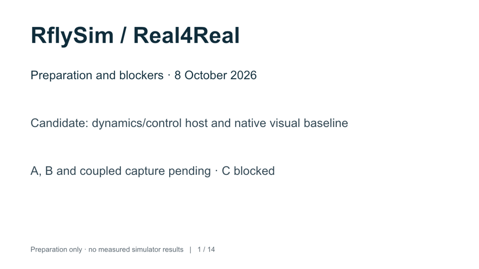
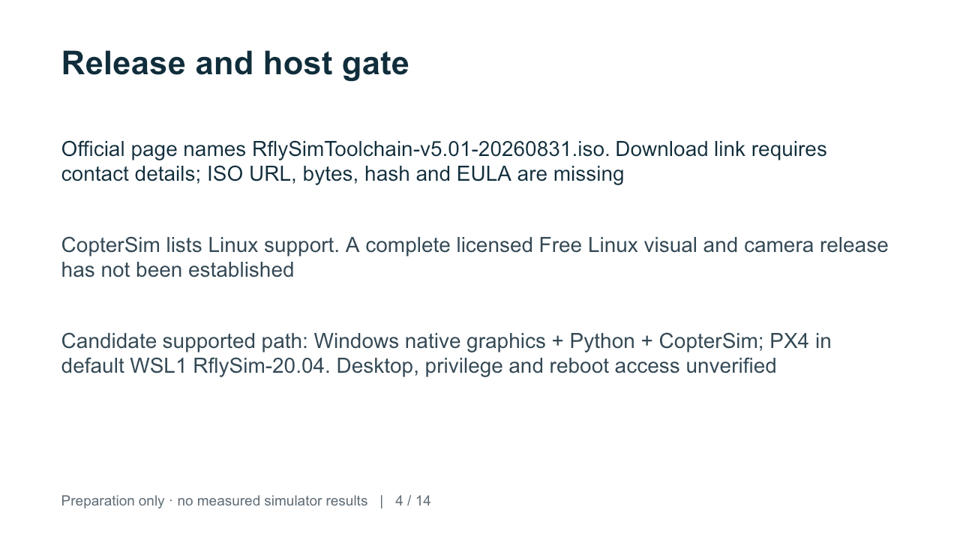
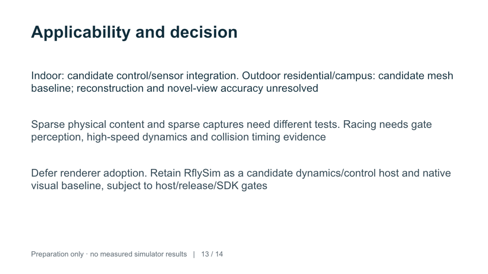

# RflySim preparation / prep-20261009T014126Z

**Preparation-ready: yes. Execution-ready: no.** No host connection, installation or simulator experiment. A, B and coupled capture are pending; C and real-capture fidelity are blocked. No measured metrics or experiment plots exist.

Branch: `audit/rflysim`; baseline commit: `2cd4f7145486854f9c84a4ae2f6aedf197e963d4`. Initial authored preparation code commit: `665926b723bb6128fe5ed0d7ca0b5a7dac3d2167` ([revision record](revision.json)); branch publishing verified. Current runner revision is available with `git log -1 --format=%H -- simulators/rflysim/run.py`. Metadata packaging commit is retrievable from this file’s Git history. Isolated worktree: `~/Downloads/AL/R4R-Sims-rflysim/`.

- [Editable RflySim preparation deck](rflysim-preparation.pptx)
- [PDF export](rflysim-preparation.pdf) — rasterized final slides; PPTX retains editable text
- [Audit and deferred commands](../../../docs/rflysim/handoff.md)
- [Interfaces/import findings](../../../docs/rflysim/interfaces.md)
- [Runner review](../../../docs/rflysim/runner-review.md), [sources](../../../docs/rflysim/sources.md), [asset inventory](../../../docs/rflysim/assets.md)
- [Numeric configuration](../../../simulators/rflysim/audit-config.json), [recovery provenance](../../../docs/rflysim/recovery.json)
- [Readiness/status](status.json), [preparation run record](run.json), [source snapshot manifest](source-manifest.json)
- [Local preservation verification](preservation.json) — source-to-worktree hashes and media checks

Recommendation: **defer renderer adoption; retain candidate dynamics/control host and native visual baseline**. Complete Free Linux graphics/camera release not established; Windows native + WSL1 is the documented planning path. Supplied SSH candidate does not establish that host path. Missing installer URL/hash/license, actual host OS/GPU/CPU/RAM/disk/driver/total price, desktop/privilege/reboot access, SDK adapter and calibrated camera/clock mapping.

Essential review media (deck/PDF/three previews) reside in this Git-tracked directory. Full slide renders and dated upstream source snapshots are locally in ignored `artifacts/rflysim/prep-20261009T014126Z/`. SSH address/access record is kept only there; key stays outside the repository. Recovery originals remain in `~/Documents/AirLab/Real4Real/sim-audit/rflysim/`.

